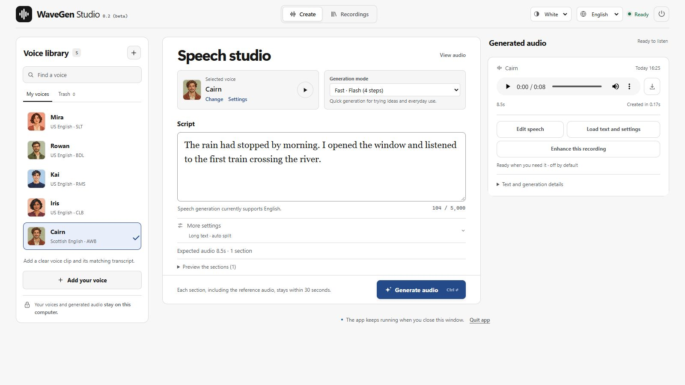

# WaveGen Studio · 0.2 (beta)

[한국어 안내](README_KO.md) · [Install](docs/INSTALL.md) · [User guide](docs/USER_GUIDE.md) · [Build](docs/BUILDING.md) · [Contribute a voice](docs/VOICE_CONTRIBUTIONS.md)

**A free, local voice studio — no subscription, no paid API.**

**Free for non-commercial use.** WaveGen model weights are licensed CC BY-NC 4.0; original Studio code is separately MIT-licensed.

A local Windows workspace for making and editing English speech with [WaveGen](https://github.com/sh-lee-prml/WaveGen). Choose a voice, write a sentence, generate, and listen beside the editor. The application runs as a native C++ EXE with a browser interface; **Python is not required to run it**.

**For the original models, paper, training, and research implementation, please refer to [WaveGen](https://github.com/sh-lee-prml/WaveGen).**

The current Windows x64 beta is **0.2.0-beta.1**. It includes five voices, a dedicated recordings library, and white and black themes.

[View the black theme](docs/images/studio-black.jpg)

## Get started

**[Download Windows beta](https://github.com/sh-lee-prml/WaveGen-Studio/releases/download/v0.2.0-beta.1/WaveGen-Studio-0.2.0-beta.1-app-windows-x64.zip)** · [Installation guide](docs/INSTALL.md)

The app ZIP is for users; GitHub's source-code ZIP is for developers.

1. Extract the app ZIP into a writable folder, then run **Install-WaveGen-Studio.cmd** to download the verified runtime and model packs. See the [installation guide](docs/INSTALL.md) for the NVIDIA driver and Microsoft runtime prerequisites.
2. Run **Launch-WaveGen-Studio.cmd**. Keep the complete application folder together.
3. Select **Mira, Rowan, Kai, Iris, or Cairn**. Preview the voice, enter a short English sentence or choose **Try a sample**, then generate. Use **Recordings** to find an earlier take.
4. Use **Add your voice** to save your own reference recording and its exact transcript.

The app and runtime come from GitHub Releases. Native Flash, V-Spec, and RE-USE model packs come from the original [LeeSangHoon/WaveGen Hugging Face repository](https://huggingface.co/LeeSangHoon/WaveGen), pinned to an immutable revision and verified by checksum. Already verified models are reused on updates.

The first request may need to load a model. Loaded models remain in memory for later requests. Closing the browser tab leaves the application running; **Quit app** releases its memory.

## What you can do

| Area | Features |
| --- | --- |
| Generate | WaveGen-Flash (4 steps) or V-Spec (50 steps), automatic long-text splitting, fixed or random seed, speed, and target duration |
| Save voices | Named reference profiles, optional images, original audio preservation, edit history, trash and restore |
| Prepare a reference | WAV/MP3 import, waveform range selection, preview, undo/redo, edge-silence trimming, optional peak adjustment |
| Enhance audio | Optional NVIDIA RE-USE **Prompt Enhancement** for references and **Speech Enhancement** for generated audio; compare before/after |
| Edit speech | Select a waveform region to keep, remove, or regenerate; save a new result while retaining the original |
| Keep working | Searchable recording history, text/settings reuse, draft persistence, cancellation, and recovery after interrupted connections |
| Choose the interface | English by default; 한국어, 简体中文, and 日本語 also available |

The two new voices are **Iris** (US English) and **Cairn** (Scottish English). Both use recordings from CMU ARCTIC. See their [reference clips, selection method, and measured WER and speaker similarity](docs/VOICE_EVALUATION.md).

## Add a voice that works well

Use a clean, complete **3–10 second English utterance** from one speaker. You can import up to 120 seconds and choose a shorter region, but the saved reference must be **under 30 seconds**. Enter exactly what is spoken in the retained audio as its **Reference Text**. Use your own recording or one you have permission to use.

The editor can trim silence and adjust peak level. It does not automatically verify the transcript, remove every recording defect, or guarantee voice similarity. Listen before saving. See the [reference workflow](docs/USER_GUIDE.md#reference-audio).

## Current limits

- **English speech input and English Reference Text.** Changing the interface language does not add another speech language.
- **Windows NVIDIA CUDA runtime.** No supported CPU-only, AMD, Intel GPU, macOS, or Linux application build is provided in this beta.
- Studio has been tested on an RTX 5080 (16 GB) and an RTX 5090 (32 GB). Memory use depends on the models loaded, text length, and enhancement.
- The native ONNX path is numerically validated but is not bit-identical to upstream PyTorch. It uses BF16 TTS inference with selected FP32 operations. A fixed seed is useful within the same setup, not a promise of identical audio across versions or devices.
- Long text is generated in sections. Pronunciation, pacing, voice similarity, and edit seams can vary. Target duration can affect pauses and articulation.
- Enhancement is optional and may change breath, timbre, or other details. Compare with the original.
- This is a local desktop application, not an authenticated multi-user internet service. Initial downloads need internet access; normal synthesis uses local assets.

## Help improve it

Bug reports, small improvements, translations, and **voice contributions** are welcome. For a proposed voice, send an audio sample, its matching Reference Text, source and license details, and a clear account of the speaker's permission. Use the [voice submission form](https://github.com/sh-lee-prml/WaveGen-Studio/issues/new?template=voice_submission.yml). Accepted samples may be added to the library **after review**; submission does not automatically publish them in a release. Please do not submit recordings you cannot share publicly. [Submission guide →](docs/VOICE_CONTRIBUTIONS.md)

For code and bug reports, see [CONTRIBUTING.md](CONTRIBUTING.md). For an existing installation, see [Updating and backup](docs/UPDATING.md).

## Credits and licenses

Thank you to **Sang-Hoon Lee and Ha-Yeong Choi** and the [WaveGen project](https://github.com/sh-lee-prml/WaveGen), [NVIDIA RE-USE](https://huggingface.co/nvidia/NVIDIA-NemotronLabs-RE-USE), the Mamba authors, ONNX Runtime, CMU ARCTIC, and the open-source projects supporting this application.

Original Studio code is [MIT-licensed](LICENSE). WaveGen checkpoints remain **CC BY-NC 4.0**. RE-USE materials, third-party libraries, runtime redistributables, and reference recordings retain their own terms. [License map and notices](docs/LICENSING.md) explain the scope; the repository's MIT license is not a license for commercial use of the WaveGen models.
